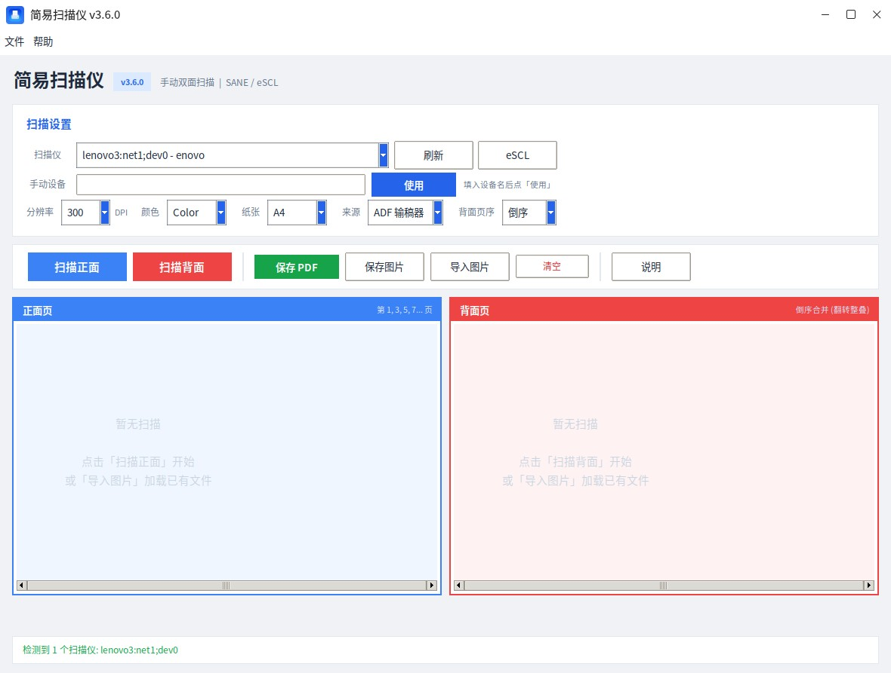

# 简易扫描仪 (Simple Scanner)

轻量级 Linux 桌面文档扫描工具，支持手动双面扫描、ADF 批量扫描，输出 PDF / PNG / JPEG。

纯 Python3 实现，全架构通用（x86_64 / ARM64 / LoongArch64）。

**版本**: 3.7.5

## 功能特性

- **手动双面扫描**：正面、背面分开扫描，自动交替合并为正确页序
- **背面页序切换**：支持「倒序」（翻转整叠）和「正序」（逐张翻页）两种模式
- **ADF 批量扫描**：使用 `scanimage --batch` 模式连续扫描全部页面，可随时停止
- **多格式导出**：PDF、PNG、JPEG
- **标准纸张 PDF**：PDF 页面严格按 A4/A3/Letter/Legal 标准尺寸生成（595.28×841.89 pt 等），不再出现"像素被当成 PDF 点、页面被放大、等效分辨率骤降"的问题
- **高分辨率支持**：100 / 150 / 200 / 300 / 400 / 600 / 1200 / 2400 DPI（按设备实际能力自动适配）
- **扫描画质增强**：中值降噪 → 对比度/亮度微调 → USM 锐化；JPEG 使用 quality=95 + 4:4:4 无色度子采样
- **图片管理**：每页可单独旋转、删除（含空白页手动删除）
- **缩略图预览**：正面/背面分区显示，实时预览
- **多协议支持**：SANE 本地扫描仪 + eSCL 网络扫描仪 (AirPrint)
- **智能参数探测**：自动解析 `scanimage --help`，按设备实际支持的 mode（Color/Gray/Lineart）传参
- **设置记忆**：分辨率、颜色、纸张、来源等参数自动保存

## 系统要求

- Python 3.8+
- tkinter（通常随 python3 自带）
- Pillow (python3-pil)
- python3-pil.imagetk（缩略图显示）
- SANE (sane-utils, scanimage 命令)
- PyMuPDF / fitz（**推荐安装**，PDF 引擎；缺失时自动回退 PIL 方案）
  - 麒麟 V10 源：`sudo apt install python3-fitz`（自带 1.16.11，已适配）
  - 其他发行版：`pip3 install PyMuPDF`

## 安装方式

### 方式一：DEB 包安装（推荐）

快速构建（自动识别本机架构）

```bash
cd docscanner_kit_v3.7.5
bash build_deb.sh
```
安装:

```bash
sudo dpkg -i docscanner_3.7.5-1_***.deb
# 若提示依赖缺失:
sudo apt-get install -f
```

安装后：

- 启动器：`/usr/bin/docscanner`
- 应用菜单：「简易扫描仪」
- 桌面快捷方式：安装时自动为各用户创建
- 卸载：`sudo dpkg -r docscanner`（保留配置）或 `sudo dpkg -P docscanner`（彻底清除）

### 方式二：脚本安装（全架构通用）

```bash
解压  docscanner_kit_v3.7.5.zip
cd docscanner_kit_v3.7.5
sudo bash install_docscanner.sh
```

脚本会安装依赖、复制文件到 `/opt/docscanner`、创建启动器和桌面快捷方式。  
卸载：`sudo bash uninstall_docscanner.sh`

### 方式三：直接运行

```bash
sudo apt install python3 python3-tk python3-pil python3-pil.imagetk sane-utils python3-fitz
python3 docscanner.py
```

## 使用指南

### 1. 连接扫描仪

打开软件后点击「刷新」自动检测 SANE 扫描仪，点击「eSCL」搜索网络扫描仪。

也可在「手动设备」栏直接填写设备名，例如：

```
lenovo3:net1;dev0
escl:http://192.168.0.169:80
```

确认设备可用：`scanimage -L`；查看设备支持的参数：  
`scanimage -d 'lenovo3:net1;dev0' --help`。

### 2. 扫描参数

| 参数   | 说明                                                                            |
| ---- | ----------------------------------------------------------------------------- |
| 分辨率  | 100 / 150 / 200 / 300 / 400 / 600 / 1200 / 2400 DPI（实际以设备支持为准，日常文档建议 300 DPI） |
| 颜色   | Color / Gray / Lineart（自动探测设备支持项）                                             |
| 纸张   | A4 / A3 / Letter / Legal                                                      |
| 来源   | 自动 / ADF 输稿器 / 平板                                                             |
| 背面页序 | 倒序（翻转整叠）/ 正序（逐张翻页）                                                            |

### 3. 手动双面扫描流程

**翻转整叠模式（默认，背面页序选「倒序」）：**

1. 将所有文档正面朝下依次放在平板上
2. 每放一张点一次「扫描正面」，扫完所有正面（第 1, 3, 5... 页）
3. 把整叠文档翻转，背面朝下
4. 依次扫描背面，程序自动倒序后合并
5. 点「保存 PDF」，页序自动排列为 1, 2, 3, 4, 5, 6...

**逐张翻页模式（背面页序选「正序」）：**

1. 放第一张纸，扫正面
2. 翻面，扫背面
3. 放第二张纸，扫正面，翻面，扫背面...
4. 保存 PDF 即可

### 4. ADF 批量扫描

将来源选为「ADF 输稿器」，放入多页文档，点击「扫描正面」。程序使用 batch 模式连续扫描**全部页面**（包括尾部的空白页），扫描过程中可点「停止扫描」中断。扫完后在预览中手动删除不需要的空白页即可，不影响最终页序。

### 5. 导出保存

| 格式   | 说明                                        |
| ---- | ----------------------------------------- |
| PDF  | 所有页面合并为标准纸张尺寸 PDF（PyMuPDF 引擎，异常时自动回退 PIL） |
| PNG  | 每页导出为独立 PNG 图片                            |
| JPEG | 每页导出为独立 JPEG 图片（q95 / 4:4:4）              |

### 6. 快捷键

| 快捷键    | 功能     |
| ------ | ------ |
| F5     | 扫描正面   |
| F6     | 扫描背面   |
| Ctrl+S | 保存 PDF |
| Ctrl+Q | 退出程序   |

## 从源码构建 DEB（各架构）

本软件为纯 Python 应用，**包内不含任何二进制文件**，因此在任意架构的机器上都可以为任意架构打包，只需要本机装有 `dpkg-deb`（Debian/Ubuntu/麒麟/UOS 自带）和 Pillow（仅用于生成 64/48px 图标；缺失时自动用 256px 原图代替）。

### 快速构建（自动识别本机架构）

```bash
cd docscanner_kit_v3.7.5
bash build_deb.sh
```

脚本通过 `dpkg --print-architecture` 自动取本机架构名，产物为：

```
docscanner_<版本>-1_<架构>.deb
```

### 指定目标架构

用 `ARCH=` 环境变量覆盖自动探测结果：

```bash
ARCH=amd64       bash build_deb.sh   # x86_64 PC
ARCH=arm64       bash build_deb.sh   # ARM64 (飞腾/鲲鹏/树莓派4等 aarch64)
ARCH=armhf       bash build_deb.sh   # ARMv7 hardfp
ARCH=mips64el    bash build_deb.sh   # MIPS64 小端 (部分老龙芯/申威系统)
ARCH=loongarch64 bash build_deb.sh   # 龙芯旧世界: 麒麟 V10 SP1 (ABI 1.0)
ARCH=loong64     bash build_deb.sh   # 龙芯新世界: Debian ports / UOS (ABI 2.0)
ARCH=all         bash build_deb.sh   # 架构无关包, 任意机器可装
```

### 架构名对照表

| 硬件 / 系统                     | `uname -m`  | dpkg 架构名        | 说明        |
| --------------------------- | ----------- | --------------- | --------- |
| 龙芯 3A6000 + 麒麟 V10SP1 旧世界   | loongarch64 | **loongarch64** | 本 kit 默认包 |
| 龙芯 + Debian ports / UOS 新世界 | loongarch64 | **loong64**     | 注意与上一行区别  |
| Intel/AMD 64 位              | x86_64      | amd64           |           |
| ARM 64 位（飞腾/鲲鹏/树莓派4）        | aarch64     | arm64           |           |
| ARM 32 位 hardfp             | armv7l      | armhf           |           |
| MIPS64 小端                   | mips64      | mips64el        |           |

目标机确认架构名：

```bash
dpkg --print-architecture
```

> **注意**：龙芯平台最容易踩的坑是架构名。麒麟 V10SP1 旧世界用 `loongarch64`，  
> Debian 新世界用 `loong64`，两者互不兼容；用错会导致 `dpkg -i` 报  
> "package architecture does not match system"。

### 构建产物说明

deb 安装布局：

| 包内路径                                             | 内容             |
| ------------------------------------------------ | -------------- |
| `/opt/docscanner/docscanner.py`                  | 主程序            |
| `/opt/docscanner/icon.png`                       | 应用图标           |
| `/usr/bin/docscanner`                            | 启动器（终端可直接运行）   |
| `/usr/share/applications/docscanner.desktop`     | 桌面菜单项          |
| `/usr/share/icons/hicolor/*/apps/docscanner.png` | 256/64/48px 图标 |
| `/usr/share/doc/docscanner/README.md`            | 本文档            |

维护脚本：`postinst`（创建各用户桌面快捷方式、清旧版残留、刷新缓存）、  
`prerm`（停止运行中的进程）、`postrm`（清理桌面残留）。

## 常见问题

**Q: 扫描仪检测不到？**

确认 `scanimage -L` 能否检测到设备。USB 扫描仪检查 udev 规则，网络扫描仪确认 IP 和端口可达。

**Q: 缩略图不显示？**

安装 `python3-pil.imagetk`：`sudo apt install python3-pil.imagetk`

**Q: 扫描参数报错？**

程序会自动降级重试（去掉不支持的参数），如仍失败可在「来源」选「自动」让驱动决定。

**Q: ADF 扫出空白页？**

程序会扫描全部页面（含空白页），扫完后在预览中手动删除空白页即可，不影响最终页序。

**Q: 背面页码顺序不对？**

检查「背面页序」设置：翻转整叠选「倒序」，逐张翻页选「正序」。

**Q: PDF 页面尺寸不对 / 看着模糊（像 72 DPI）？**

3.7.0 已修复：旧版用 PIL 直接存 PDF 时会把像素数当成 PDF 点数，导致页面被放大、  
阅读器里等效分辨率骤降。现改用 PyMuPDF 按标准纸张尺寸排版。请确认  
`python3-fitz` 已安装；未安装时会回退 PIL 方案（多页尺寸可能不准，状态栏会提示）。

**Q: 麒麟系统保存 PDF 报 `KeyError: 'width'`？**

系统自带的 `python3-fitz` 1.16.11（2020 年）解析 JPEG 有已知缺陷。3.7.4 起  
已绕开其解码器，改用原始 RGB 像素（Pixmap）直接嵌入，升级后不再出现。  
若仍有异常，错误堆栈会写入 `~/docscanner_pdf_error.log`。

**Q: 构建/安装时报 `module 'PIL.Image' has no attribute 'Resampling'`？**

系统 Pillow 版本低于 9.1。3.7.5 起脚本已兼容（自动回退 `Image.LANCZOS`）。  
也可升级：`pip3 install -U Pillow`。

**Q: deb 安装报架构不匹配？**

核对 `dpkg --print-architecture` 与 deb 文件名中的架构；龙芯旧世界用  
`loongarch64`，新世界用 `loong64`，或直接在目标机上 `bash build_deb.sh` 重新构建。

## 修改日志（Changelog）

### v3.7.5

- 新增 DEB 打包支持（`build_deb.sh`），自动识别 `dpkg --print-architecture`，  
  支持 `ARCH=<架构>` 覆盖，已验证龙芯麒麟 V10SP1 的 `loongarch64` 包
- deb 安装布局标准化：`/usr/bin` 启动器、桌面菜单项、hicolor 图标、  
  `postinst/prerm/postrm` 维护脚本、各用户桌面快捷方式自动创建/清理
- 修复 `build_deb.sh`、`install_docscanner.sh` 在 Pillow < 9.1（麒麟自带版本）  
  上因 `Image.Resampling` 不存在而报错的问题，自动回退 `Image.LANCZOS`；  
  无 Pillow 的构建机用 256px 原图代替缩放图标
- README 更新：完整安装指南、跨架构构建说明、修改日志

### v3.7.4

- 修复麒麟自带 PyMuPDF 1.16.11 保存 PDF 报 `KeyError: 'width'` 的问题：  
  该版本 `insertImage` 的 JPEG 解码路径（stream/filename 两种方式均受影响）  
  存在缺陷；改为对 1.16~1.17 使用原始 RGB 像素构造 Pixmap 后直接  
  `insertImage(rect, pixmap=...)`，完全绕过图像格式解析
- PyMuPDF ≥ 1.18 继续使用 JPEG（quality=95, 4:4:4）嵌入，PDF 体积更小
- PyMuPDF 保存失败时自动回退 PIL 方案，不再整体保存失败；  
  异常详情写入 `~/docscanner_pdf_error.log`

### v3.7.3

- 适配老版本 PyMuPDF（1.16.x）API：`newPage` / `insertImage` 方法名与调用签名
- 嵌入图像调用增加多形态尝试与错误收集

### v3.7.0

- **修复 PDF 页面尺寸错误（核心问题）**：旧版用 PIL 保存 PDF 时忽略 DPI 元数据，  
  把像素数直接当作 PDF 点数（如 815×1158 px 被存成 815×1158 pt 的"页面"），  
  导致阅读器中页面远大于 A4、等效 DPI 仅约 72、观感模糊。  
  改用 PyMuPDF 按 A4/A3/Letter/Legal 标准尺寸（如 A4 = 595.28×841.89 pt）排版
- PDF 嵌入图像使用 JPEG quality=95 + `subsampling=0`（4:4:4，无色度抽样），  
  改善文字边缘与纸张偏色观感
- 新增扫描图像后处理：3×3 中值降噪、对比度 1.15、亮度 1.03、  
  UnsharpMask(radius=1.5, percent=120, threshold=3)
- 三处扫描路径（平板单页、ADF batch、ADF 回退循环）写入扫描 DPI 元数据
- 分辨率选项扩展为 100/150/200/300/600/1200/2400
- 新增 scanimage mode 智能探测：解析 `scanimage -d <dev> --help` 输出，  
  按别名表（Color/24bit Color/RGB 等）匹配设备实际支持的 mode
- 安装脚本新增 `python3-fitz`（apt）/ `PyMuPDF`（pip）依赖与安装验证
- 关于/帮助文本同步更新


## 技术信息

- 语言：Python 3
- GUI：tkinter + ttk
- 图像：Pillow (PIL)
- 扫描：SANE (scanimage)
- PDF：PyMuPDF (fitz)，PIL 回退；已验证 fitz 1.16.11（麒麟 V10SP1）~ 1.27.x
- 打包：dpkg-deb，纯 Python，架构无关源码、按目标架构命名 deb
- 作者：frozenzero123
- GitHub：<https://github.com/frozenzero123/docscanner>

> 本软件由 Trae AI 指令辅助生成
